<div align="center">

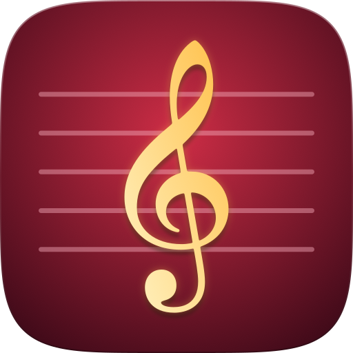

<h1>Etude</h1>

**Learn piano with falling notes on a MIDI keyboard, a touch screen or your computer.**

Free and open source, built for Raspberry Pi 5 and running on macOS and Linux.

Designed for touch first, on a screen of 13 inches or more (15 inches is ideal).


[](https://github.com/techneissa/etude/actions/workflows/ci.yml)
[](https://github.com/techneissa/etude/releases)
[](https://github.com/techneissa/etude/stargazers)

<a href="https://buymeacoffee.com/techneissa"></a>
<a href="https://ko-fi.com/P3E528MZS0"></a>

</div>

---

<p align="center">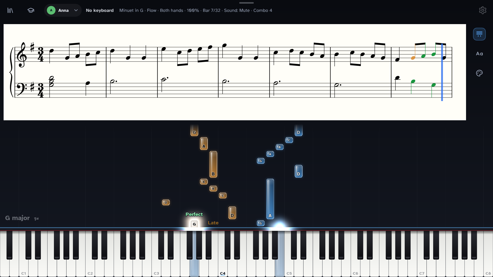</p>

## Features

<table>
<tr>
<td width="50%" valign="top">
&nbsp;<b>Play</b><br>
Notes fall to the keys. Flow grades you, Wait waits.<br>
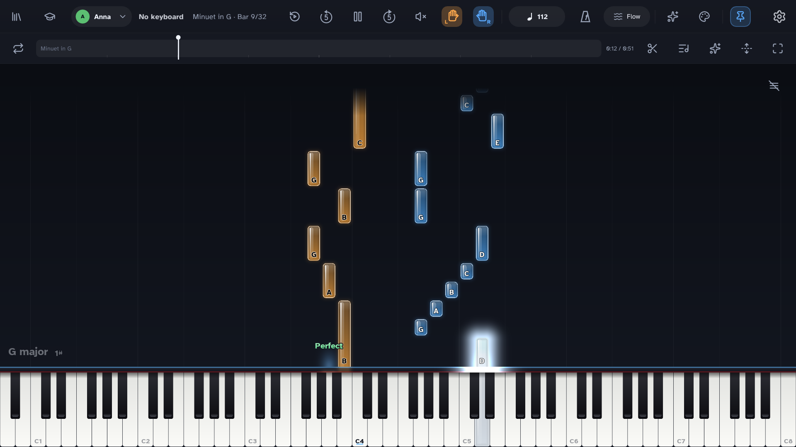
</td>
<td width="50%" valign="top">
&nbsp;<b>Three views</b><br>
Falling notes, sheet music, or both.<br>
<a href="docs-public/screenshots/falling.png">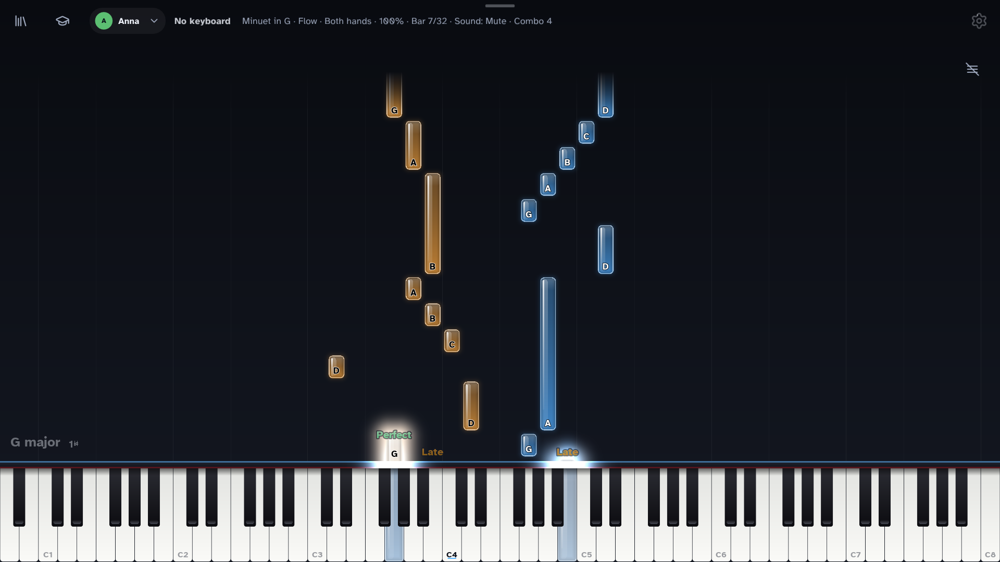</a> <a href="docs-public/screenshots/dual.png"></a> <a href="docs-public/screenshots/sheet.png">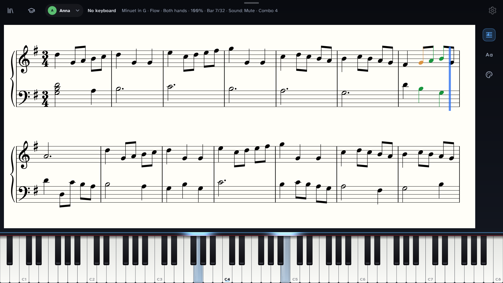</a>
</td>
</tr>
<tr>
<td width="50%" valign="top">
&nbsp;<b>Song library</b><br>
Search, sort and group your songs, or get free ones.<br>
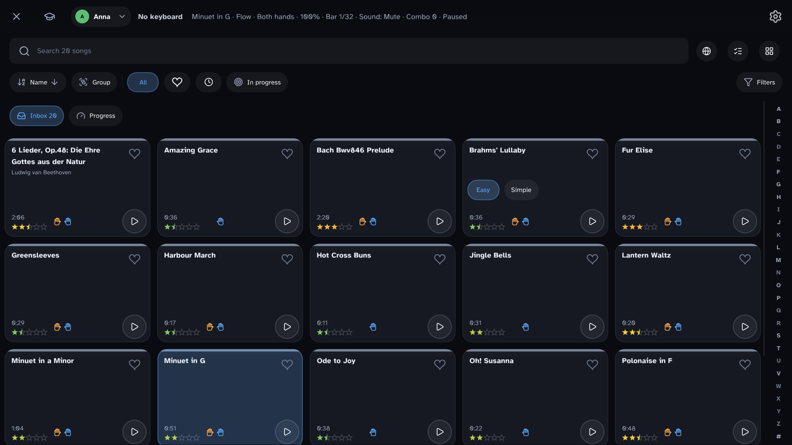
</td>
<td width="50%" valign="top">
&nbsp;<b>Practice</b><br>
Loops, sections, practice lists, speed and one hand.<br>
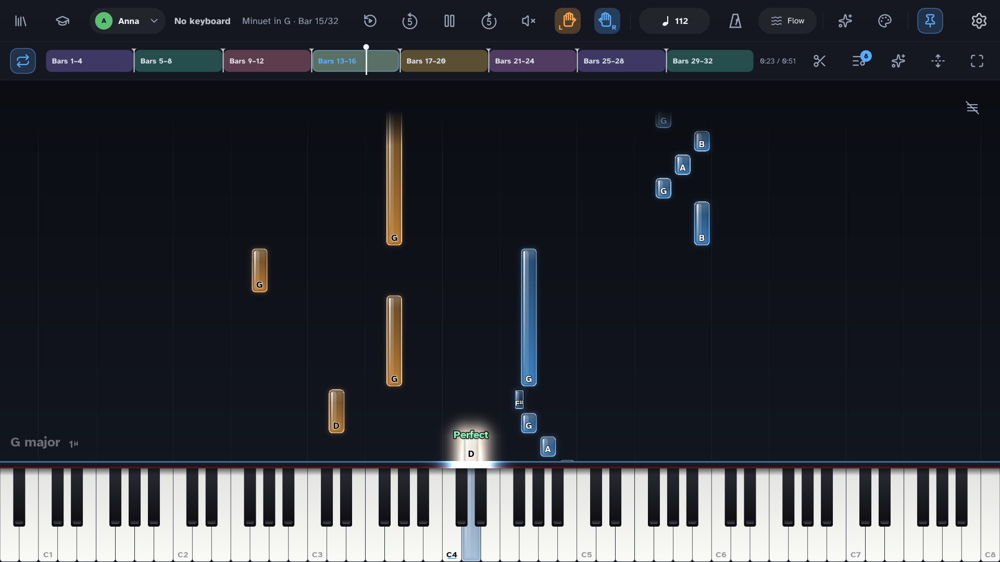
</td>
</tr>
<tr>
<td width="50%" valign="top">
&nbsp;<b>Learn</b><br>
Scales, chords, ear training and melodies.<br>
<a href="docs-public/screenshots/learn.png">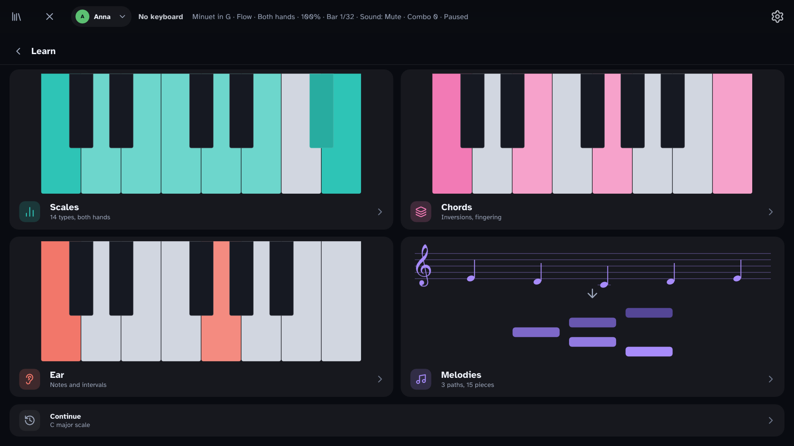</a> <a href="docs-public/screenshots/learn-scales.png">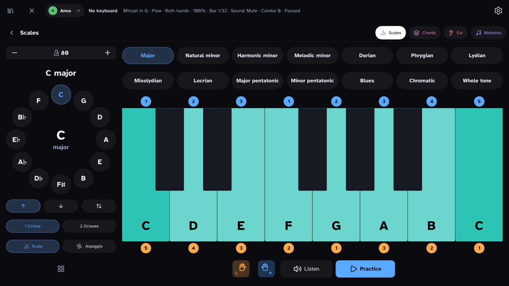</a>
</td>
<td width="50%" valign="top">
&nbsp;<b>Profiles</b><br>
A profile for each player, with its own streak.<br>
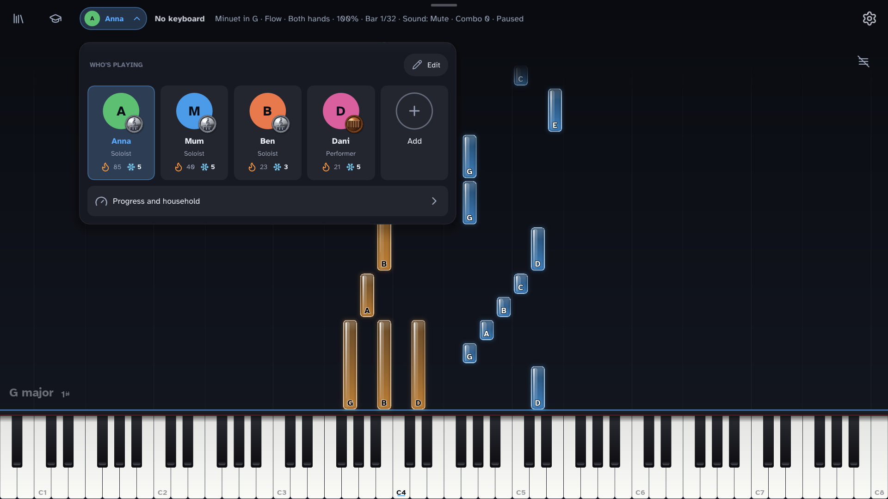
</td>
</tr>
<tr>
<td width="50%" valign="top">
&nbsp;<b>Achievements</b><br>
Medals, streaks and progress charts.<br>
<a href="docs-public/screenshots/progress.png">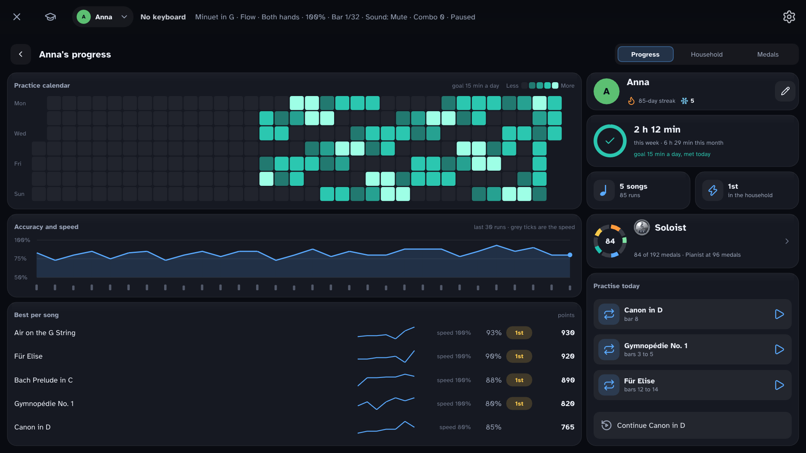</a> <a href="docs-public/screenshots/medals.jpg">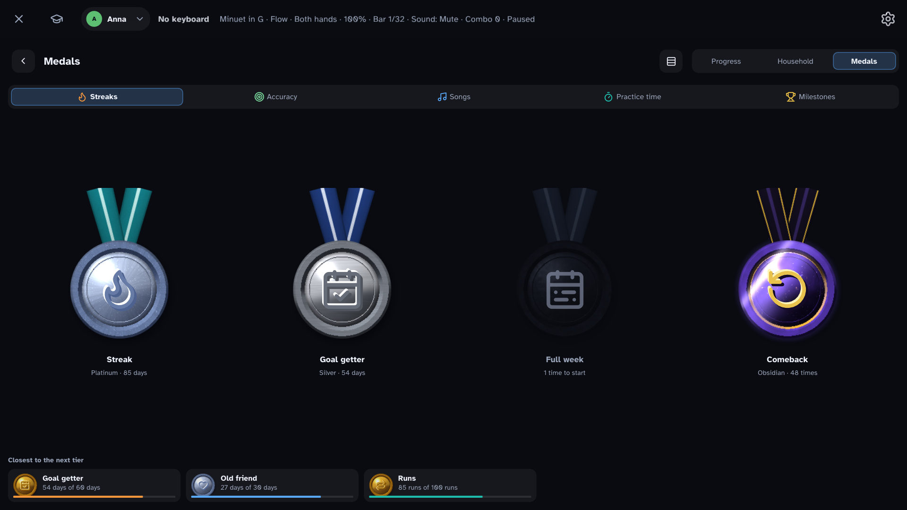</a>
</td>
<td width="50%" valign="top">
&nbsp;<b>Effects</b><br>
Note styles, colours and hit effects.<br>
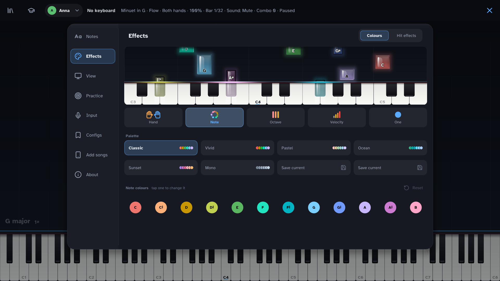
</td>
</tr>
</table>

Also: play with a USB MIDI keyboard, the on-screen keys, your computer keyboard or a microphone (experimental). Open MIDI, MusicXML, MuseScore and ABC songs, and add them from a USB stick, a network folder or a phone. Update from the app, with rollback.

## Getting started

You need a C++20 compiler, CMake 3.25 or newer, [Ninja](https://ninja-build.org) and [just](https://github.com/casey/just).

1. Install the tools.
   - **macOS:** `xcode-select --install`, then `brew install cmake ninja just`.
   - **Linux (Debian, Ubuntu, Raspberry Pi OS):** `sudo apt install build-essential cmake ninja-build pkg-config libasound2-dev libudev-dev libdrm-dev libgbm-dev libegl-dev libgles-dev libx11-dev libxext-dev libxcursor-dev libxi-dev libxfixes-dev libxrandr-dev libxss-dev libxtst-dev libwayland-dev libxkbcommon-dev wayland-protocols libdecor-0-dev libcurl4-openssl-dev`
2. Build and run:

   ```
   just build    # configure and build everything
   just run      # build and start the app
   ```

The first configure downloads the dependencies and the piano samples (148 MB, cached once per user). For a silent piano without the samples, configure with `-DETUDE_PIANO_FROM_SOURCE=OFF`.

## Using it

Put song files in the `Songs` folder of the settings folder, or open one with `etude --song FILE`. The settings folder is `~/Library/Application Support/io.github.techneissa.etude` on macOS and `~/.local/share/io.github.techneissa.etude` on Linux.

- **Top row:** the song library, Learn, the profile switcher and the settings (gear).
- **Bar:** tap the handle at the top for play, skip, hands, tempo, Flow or Wait and the song's sections.
- **Sheet music:** the button beside the score switches between falling notes, sheet and both.
- **(i) buttons:** each setting explains itself.

| Key | Action |
| --- | --- |
| `A S D F G H J K L ; '` | White keys from middle C (`W E T Y U O P`: black keys) |
| `Z` / `X` | Octave down / up |
| `Space` | Play / pause |
| `←` / `→` | Skip back / forward |
| `↑` / `↓` | Speed +5% / −5% |
| `[` `]` `\` | Loop start, loop end, clear loop |
| `1` `2` `3` | Right hand, left hand, both |
| `Q` | Flow / Wait mode |
| `Page Down` / `Page Up` | Next / previous song |
| `Esc` | Close the settings, then quit |

`etude --help` lists the other options.

## Raspberry Pi

On Raspberry Pi OS (64-bit), run `just pi-setup`. It installs the packages, builds in Release, installs the app to `/opt/etude` and sets it to start on the console. `just pi-setup --dry-run` prints the plan first. [deploy/pi/CHECKLIST.md](deploy/pi/CHECKLIST.md) lists the hardware checks.

## Roadmap

Next, for v1:

- [ ] Hardware tests on a Raspberry Pi 5 with a touch screen.
- [ ] Tests with real keyboards.

After that:

- [ ] Reliable microphone detection for chords and low notes.
- [ ] A second screen.
- [ ] Edit notes and record your own songs.
- [ ] Import from PDF, images and audio.
- [ ] Follow mode: the tempo eases down when you fall behind.
- [ ] Better touch handling, real-time priority and a fuller piano sound.
- [ ] Online friends and shared streaks.

## Contributing

- Open an issue before a large change; a small fix can go straight to a pull request.
- Build with `just build` and run `just test`.
- Format with `just format` before you push.
- The code rules are in [CONTRIBUTING.md](CONTRIBUTING.md).

## Licence and credits

Etude is free software under the GPL-3.0-or-later; see [LICENSE](LICENSE). The libraries, fonts, icons, music and sound it uses are listed in [CREDITS.md](CREDITS.md).
